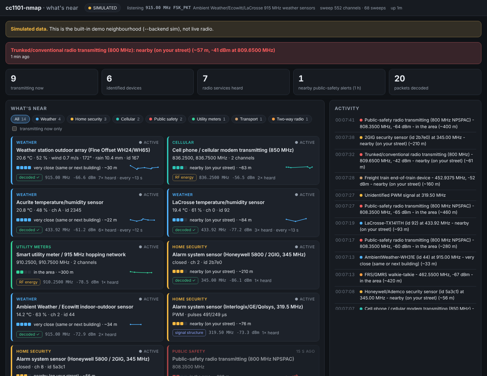

# cc1101-nmap

**What's transmitting near me?** A passive, receive-only sub-GHz scanner for the
[Evil Crow RF V2](https://github.com/joelsernamoreno/EvilCrowRF-V2) (ESP32 + two CC1101s). It identifies real devices
around you (weather stations, alarm sensors, utility meters, doorbells), notices radios it can't
decode (police/fire radios keying up next door, phones, LoRa, a passing freight train), estimates
how close each one is, and shows it all on a live web dashboard.



It only reports things that exist and behave the way the catalog says they do: no entropy guessing,
no "possible spy bug". Every identification carries how it was made:

| Badge | Meaning |
|---|---|
| **decoded ✓** | Packet decoded and its CRC/checksum verified. This exact device, with its readings. |
| **signal structure** | A clearly man-made signal (tight, repeating timing) that no decoder knows yet; named by band. |
| **RF energy** | A transmission we can measure but not demodulate (P25, TETRA, LTE, LoRa); named by band plan and behaviour. |

## What it can see

Run `python3 -m cc1101nmap --list` to print exactly what's detectable with your settings.

| Category | Examples | How |
|---|---|---|
| Weather | Acurite 592TXR tower, LaCrosse TX141TH, LaCrosse IT+ (TX29/TX35), Fine Offset WH24/WH65 (Ambient WS-2902, Ecowitt WS69), Ambient WH31E | decoded |
| Home security | Honeywell/Ademco 5800 and 2GIG sensors at 345 MHz: open/closed, alarm, tamper, battery | decoded |
| Remotes & openers | EV1527/PT2262 doorbells/sensors/remotes, Linear MegaCode 318 MHz gate remotes & PERS pendants (replayable codes redacted by default) | decoded |
| Vehicles | Schrader TPMS wheel sensors at 315/433.92 MHz (persistent tire tracking IDs redacted by default) | decoded |
| Utility meters (EU) | Wireless M-Bus T1/C1: manufacturer, serial and type of water/heat/gas meters | decoded |
| Medical & distress (`--allow-sensitive`) | Medtronic MiniMed insulin pumps/CGM (916.5/868.35 MHz), Omnipod Eros pumps (433.91 MHz) — presence/role only; plus MedRadio implants, US EMS UHF MED channels, 406 MHz PLB/EPIRB/ELT beacons, EU social alarms & Annex 7 safety alarms | decoded / RF energy |
| Public safety (US) | Radios transmitting on 700 MHz (799-805) and 800 MHz (806-816) public-safety bands; trunked sites (851-861) | RF energy |
| Public safety (EU) | TETRA emergency-services terminals (380-385 MHz) and base stations (390-395) | RF energy |
| Government | US federal 406-420 MHz radios | RF energy |
| Cellular | Phones and modems transmitting (850 MHz, Band 13, FirstNet Band 14; EU LTE 800/900) | RF energy |
| Other | Freight-train end-of-train devices, FRS/GMRS/PMR446 walkie-talkies, LoRaWAN, Meshtastic, Z-Wave, smart-meter mesh, radiosondes | RF energy |
| Unidentified | Anything structured on 315/319.5/433.92/868 MHz: key fobs, other TPMS, Interlogix sensors... | signal structure |

### "Police at the neighbour's", honestly

A CC1101 can't demodulate P25 or TETRA, and it shouldn't: content is often encrypted and
listening may be illegal where you live. What it *can* do is notice that a radio on a
public-safety **mobile-transmit** frequency just keyed up, and how strong it was. Base stations
transmit from towers all the time, so the scanner watches the frequencies that *handhelds and
vehicles* transmit on. A strong burst there means a radio is close. That's the same idea as
"Close Call" on consumer scanners.

To turn "a public-safety radio" into "Sheriff dispatch" or "Fire", give it your area's
frequencies (from RadioReference or your county's published plan):

```bash
python3 -m cc1101nmap --local-freqs local_freqs.csv
```

`local_freqs.example.csv` shows the format (`freq_mhz,label,category,alert`). RadioReference-style
exports also work. For 700/800 MHz system outputs, and UHF rows marked as repeater outputs, the
mobile-transmit frequency is derived from the band plan automatically.

Limits you should know about:
- **VHF is invisible.** Many rural police and fire departments and most fire pagers are on 150-174 MHz,
  which a CC1101 can't tune. The tuning ranges are 300-348, 387-464 and 779-928 MHz, or with
  `--extended-range` roughly 281-361, 378-481 and 749-962 MHz at reduced sensitivity.
- Energy detection can't tell police from fire from public works on a shared band; the local list fixes that.
- Distance comes from signal strength and each emitter's typical power, using a log-distance
  path-loss model (`--path-loss`, default 2.7). Read it as "next door / on your street / in the area / far",
  not a position. Walls, antennas and terrain move it by 2-3x.

## Hardware paths

| | Stock Evil Crow firmware | cc1101-nmap companion firmware |
|---|---|---|
| Flash anything? | No | Yes (`firmware/`) |
| Decoded OOK devices (433/315/318/345 MHz) | Yes | Yes, with signal strength |
| Packet devices (915/868 MHz weather, wM-Bus, sensitive pumps) | No (stock filters pulses < 100 µs) | Yes (CC1101 hardware packet engine) |
| RSSI sweep: public safety, cellular, LoRa... | No (no RSSI interface) | Yes, up to 600 channels per sweep |
| Distance estimates | No | Yes |
| Transmit capability | Yes (stock has TX/jammer) | **None. Receive-only.** |

**Stock firmware.** The scanner uses the stock web routes (`/setrx`, `/stoprx`, `/logs`,
`/delete`) and decodes the pulse captures it writes to the SD card (an SD card must be in).
The stock interrupt handler records both CC1101s into one buffer, so the scanner listens with
one module at a time and rotates it through 433.92/315/345/319.5/318 MHz.

**Companion firmware** (`firmware/cc1101_nmap/`). Module 1 sweeps RSSI continuously with
peak-hold; module 2 captures pulses (with glitch filtering, signal strength and squelch) or
receives FSK/OOK packets by sync word. It reads Wi-Fi settings from the same SD `wifi_config.txt`
the stock firmware uses, answers as `evilcrow-rf.local`, and its root page links to your
dashboard once the scanner connects. Build and flash with PlatformIO:

```bash
cd firmware && pio run -t upload
```

(Or Arduino IDE: open `cc1101_nmap/cc1101_nmap.ino`, board "ESP32 Dev Module", install
SmartRC-CC1101-Driver-Lib.) To go back, re-flash the stock firmware.

> Status: the companion firmware compiles cleanly against ESP32 Arduino 2.0.17 (PlatformIO
> espressif32 6.9.0) but has not been run on a physical Evil Crow yet. If something misbehaves,
> run the scanner with `--record session.jsonl` and open an issue with the file.

## Quick start

```bash
pip install -r requirements.txt
```

Try it without hardware (simulated neighbourhood, clearly labelled as such):

```bash
python3 -m cc1101nmap --backend sim
```

Open `http://<this machine>:8080/`.

With an Evil Crow on your network (the firmware is detected automatically):

```bash
python3 -m cc1101nmap --host evilcrow-rf.local
```

In Europe:

```bash
python3 -m cc1101nmap --host evilcrow-rf.local --region EU --extended-range
```

Run it as a service on a Raspberry Pi: copy the repo to `/opt/evilcrow`, create the venv, then
install `evil_nmap.service` (instructions at the top of that file). `./evilcrow_scanner.py` still
works as the entry point.

Useful options: `--json` (events as JSON lines on stdout), `--events-log FILE`,
`--record FILE` / `--backend replay --replay FILE` (capture a session and replay it later),
`--allow-sensitive` (show replayable codes, persistent TPMS IDs, and health/distress/medical bands & devices), `-q` (warnings and alerts only).

## Dashboard and API

The dashboard is a single self-contained page (no CDN, works on an offline Pi) served at `/`:
what's near (filterable by category, with distance and signal history), an activity feed with
alerts, the live spectrum, and infrastructure in range. The JSON API is open for your own
tooling or Home Assistant:

| Endpoint | |
|---|---|
| `GET /api/state` | everything: devices, RF activity, events, latest spectrum |
| `GET /api/events?since=N` | events after sequence N |
| `GET /api/catalog` | what can be detected, sweep plan, RX profiles |
| `GET /api/stream` | Server-Sent Events, a snapshot whenever something changes |

The dashboard listens on all interfaces by default (`--web-host 127.0.0.1` to restrict).
It reveals what's around your location, so don't expose it to the internet.

## Privacy and the law

- Receive-only. Nothing here transmits; the companion firmware has no TX code path.
- No voice or message content is demodulated. Public-safety, cellular and LoRa detection is signal strength only.
- Replayable fixed remote codes (EV1527/PT2262, Linear MegaCode) and persistent vehicle-tracking IDs (Schrader TPMS) are redacted unless `--allow-sensitive`.
- Health-, distress- and safety-related bands and devices (MedRadio implants, US EMS UHF MED channels, 406 MHz PLB/EPIRB/ELT distress beacons, EU social alarms and Annex 7 safety alarms, Medtronic MiniMed and Omnipod Eros pumps) are hidden — and their dedicated RX profiles are not tuned — unless `--allow-sensitive`. Even with `--allow-sensitive`, insulin pump decoders report device presence/role only and never decode clinical readings or dosing payloads.
- Rules on receiving radio differ by country, and some restrict using scanners in vehicles or
  for certain services. You're responsible for using this where it's legal.

## Development

```bash
python3 -m unittest discover -s tests
```

Decoder tests use packets captured from real devices, as published in rtl_433's protocol
documentation, plus round-trips through the encoders the simulator uses. The HTTP backends
are tested against fake devices that mimic the stock firmware's routes and the companion
firmware's API.

```
cc1101nmap/
  catalog.json     what transmits where (band plans, typical power, meaning)
  catalog.py       catalog loading, sweep planning, local frequency lists
  decoders.py      checksum-verified protocol decoders
  pulses.py        pulse slicers, stock log parser, noise vs signal test
  engine.py        tracking, noise floor, proximity, events
  backends.py      stock firmware, companion firmware, replay
  sim.py           simulated neighbourhood (--backend sim)
  web.py           HTTP server + API;  dashboard.html  the UI
firmware/          receive-only companion firmware (PlatformIO / Arduino)
```

Adding a device: write a decoder with a real integrity check (`decoders.py`), add a catalog
entry describing what it is, and add a test with a real captured packet.

Protocol layouts follow the documentation collected by the
[rtl_433](https://github.com/merbanan/rtl_433) project and EN 13757-4 (wireless M-Bus);
the implementations here are independent.
